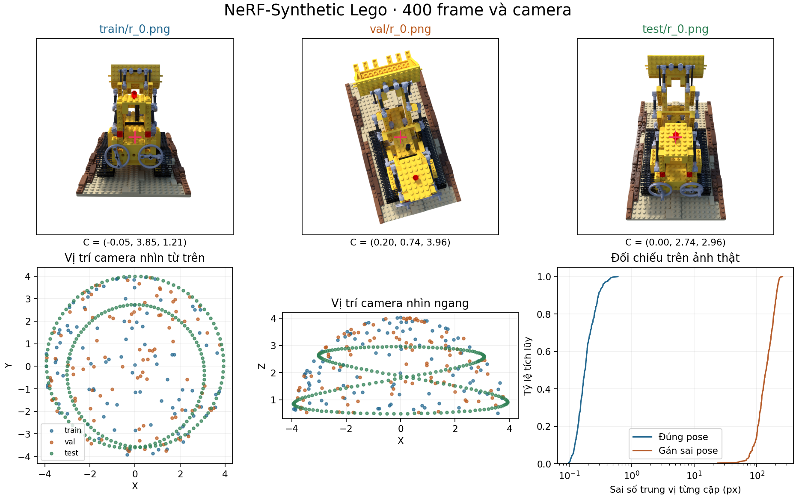

# NeRF-Synthetic Lego · Kiểm tra dữ liệu và camera

**Kết quả ngày 23/11/2026.** Cả 400 frame đạt kiểm tra cấu trúc và hình học camera. Phép đối chiếu bằng ảnh hỗ trợ 399/400 frame trong cùng tập và xác nhận thêm frame còn lại bằng một cặp khác tập. Kết quả thực nghiệm nằm trong `final/`. Thư mục `results/` chứa lượt thăm dò có cặp ảnh tự ghép và đã được loại khỏi thống kê.

## Bước 1 — Xác nhận đầu vào

Đọc ba JSON độc lập. Với từng frame, giải đường dẫn PNG tương đối, kiểm tra đúng tập, tính duy nhất, giải mã toàn bộ pixel và kiểm tra trường `transform_matrix` có dạng mảng số hữu hạn 4 × 4. Đối chiếu ngược danh sách ảnh màu thực có với danh sách trong JSON. Đối chiếu cả danh mục tệp và nội dung SHA-256 với bản bàn giao P06.

| JSON | Frame | PNG màu đọc được | Kích thước | Kênh |
|---|---:|---:|---|---|
| transforms_train.json | 100 | 100 | 800 × 800 | RGBA |
| transforms_val.json | 100 | 100 | 800 × 800 | RGBA |
| transforms_test.json | 200 | 200 | 800 × 800 | RGBA |

Số đường dẫn thiếu, trùng hoặc ảnh màu dư đều bằng 0. Tất cả ảnh màu có pixel alpha bằng 0 và pixel alpha bằng 255. Kiểm tra độc lập 200 PNG depth và 200 PNG normal của tập test, từng ảnh giải mã được ở 800 × 800. Cả 803 tệp khớp SHA-256. [Tổng hợp](final/dataset.json) · [400 bản ghi bàn giao cho Bước 2, gồm ảnh, FOV và ma trận gốc](final/frames.json)

## Bước 2 — Xác nhận hình học

**Nội tại.** Ba split cùng khai báo góc nhìn ngang 0,691111207 radian. Mô hình pinhole dùng pixel vuông và tâm ảnh ở giữa. Với chiều rộng W và chiều cao H, tính fx = W / [2 tan(FOVx/2)], fy = fx và FOVy = 2 atan[H / (2 fy)]. Với ảnh Lego, FOVx = FOVy = 39,59776°, fx = fy = 1111,11103 px. K theo quy ước tạo tia NeRF có tâm (400, 400). JSON cung cấp FOV ngang, còn tiêu cự pixel, FOV dọc và tâm ảnh được suy ra theo mô hình. [Mã tạo tia NeRF](https://github.com/bmild/nerf/blob/master/run_nerf_helpers.py#L109-L126)

**Ngoại tại.** Với T camera-to-world của Blender, tâm camera thế giới C = T[:3,3], hướng nhìn thế giới là −T[:3,2]. Đổi cơ sở bằng D = diag(1,−1,−1,1), rồi lấy V = (T D)⁻¹ để có world-to-camera theo quy ước GraphDECO. Khi viết V = [Rwc | t], hệ thức Rwc C + t = 0 cho phép kiểm tra vị trí và translation độc lập với cách gọi tên biến. Ở train/r_0.png, C ≈ (−0,05380; 3,84547; 1,20808), hướng nhìn ≈ (0,01335; −0,95394; −0,29969), còn t ≈ (0; 0; 4,03113). [Dữ liệu của từng camera](final/cameras.json) · [Trình đọc GraphDECO](https://github.com/graphdeco-inria/gaussian-splatting/blob/main/scene/dataset_readers.py#L215-L224)

| Phép kiểm tra trên 400 pose | Tiêu chí | Kết quả |
|---|---|---|
| Hàng cuối ma trận | Sai số phần tử so với [0,0,0,1] < 10⁻⁷ | 400/400 đạt |
| Phép quay | Sai số phần tử lớn nhất của RᵀR − I và độ lệch det(R) so với 1 đều < 10⁻⁵ | Lớn nhất lần lượt 1,254 × 10⁻⁶ và 3,335 × 10⁻⁷ (làm tròn lên) |
| C và translation | Chuẩn của Rwc C + t < 10⁻⁸ đơn vị cảnh | Lớn nhất 1,334 × 10⁻¹⁵ |
| Hướng nhìn của cảnh Lego | Gốc thế giới phía trước và lệch tâm dưới 0,01 px | Lớn nhất 0,0000553 px |
| Tạo tia rồi chiếu ngược | Sai số < 10⁻⁶ px cho 9 pixel × 2 độ sâu × 400 camera | 7.200/7.200 đạt, lớn nhất 1,98 × 10⁻¹² px |

Lấy tia qua tâm, bốn góc và bốn điểm giữa biên của lưới pixel, đặt điểm thử tại độ sâu camera 1 và 4 đơn vị, rồi chiếu về ảnh bằng FOV và quy ước trục GraphDECO. Ánh xạ từ tọa độ thiết bị chuẩn hóa (NDC) vào raster đặt trục quang tại chỉ số (399,5; 399,5) khi đánh số tâm pixel từ 0. Vì vậy tọa độ kỳ vọng của một tia NeRF tại (u,v) là (u−0,5; v−0,5) ở phép đối chiếu này. Sai số làm tròn đo được phản ánh tính nhất quán của các công thức trên CPU. [Phép chiếu GraphDECO](https://github.com/graphdeco-inria/gaussian-splatting/blob/main/utils/graphics_utils.py#L48-L72) · [Ánh xạ vào chỉ số pixel](https://github.com/graphdeco-inria/diff-gaussian-rasterization/blob/main/cuda_rasterizer/auxiliary.h#L37-L40)

**Kiểm tra bằng ảnh thật.** Cho mỗi frame, chọn một camera trong cùng split có góc giữa hai vectơ vị trí gần 8° nhất, yêu cầu góc ≥ 2°, rồi gộp các cặp không thứ tự trùng nhau. Góc thực tế của 325 cặp nằm trong khoảng 2,78–17,21°. Ghép SIFT hai chiều trên vùng alpha > 240 với phép thử tỷ số 0,75. Tính ma trận cơ bản từ pose và K đã biết, đo căn sai số Sampson, sau đó tam giác hóa các điểm có sai số ≤ 1 px. Một frame được tính có bằng chứng hình ảnh khi tham gia ít nhất một cặp có ≥ 10 điểm đạt ngưỡng và ở trước cả hai camera. Đây là ngưỡng vận hành của thí nghiệm. Đối chứng giữ nguyên điểm ghép và thay pose thứ hai bằng một camera xa về góc. [Số đo từng cặp](final/pairs.json)

| Tập | Cặp ảnh | Điểm ghép | ≤ 1 px | Đạt và ở trước hai camera | ≤ 1 px khi gán sai pose |
|---|---:|---:|---:|---:|---:|
| Train | 69 | 8.906 | 7.357 | 7.357 | 32 |
| Val | 72 | 9.372 | 7.810 | 7.810 | 35 |
| Test | 184 | 30.295 | 25.927 | 25.919 | 111 |
| Tổng | 325 | 48.573 | 41.094 | 41.086 | 178 |

**Trường hợp cần xem riêng.** Cặp val/r_5 và val/r_19 có 9/12 điểm đạt cả sai số và độ sâu, dưới tiêu chí 10 điểm. Khi kiểm tra bổ sung val/r_5 với test/r_121, có 60/78 điểm đạt cả hai điều kiện và 0/78 đạt dưới đối chứng sai pose. Đây là kiểm tra chéo chỉ phục vụ xác minh dữ liệu. Ngoài ra, test/r_51 và test/r_151 là cặp pose duy nhất có sai lệch lớn nhất theo phần tử ≤ 10⁻⁵ (đo được 6,60 × 10⁻⁶). Tập test vẫn có 200 frame khai báo. [Kết quả kiểm tra bổ sung](final/followup.json) · [Manifest](final/manifest.json)



Dấu cộng trên ảnh đánh dấu tâm chiếu. Các biểu đồ phía dưới thể hiện vị trí tâm camera trong hệ thế giới và phân bố sai số của 325 cặp chính. Kiểm tra đại số đo sự nhất quán của phép biến đổi. Đối chiếu ảnh đo sự phù hợp với nội dung quan sát được, có thể chịu ảnh hưởng bởi họa tiết Lego lặp lại. Các kết quả xác nhận đầu vào ở mức hình học. Việc chạy renderer CUDA và đo chất lượng reconstruction thuộc thí nghiệm sau.

## Tái lập

Chạy từ thư mục gốc dự án với Python thông thường (chế độ `-O` tắt các kiểm tra assert). Phiên bản dùng cho phép đo được ghi trong manifest. Lệnh đầu yêu cầu đường dẫn đầu ra mới. Lệnh thứ hai tạo hình bằng Matplotlib.

```sh
python3 -B runs/lego/inspection_002/run.py runs/lego/inspection_002/repeat
python3 -B runs/lego/inspection_002/figure.py runs/lego/inspection_002/repeat
```

